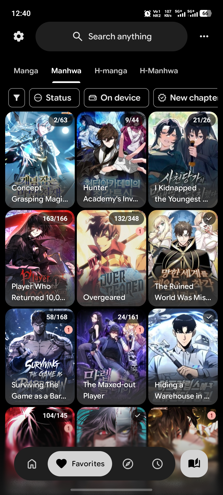
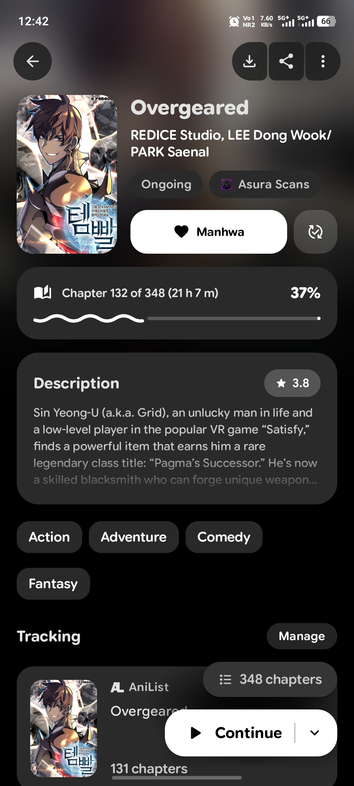
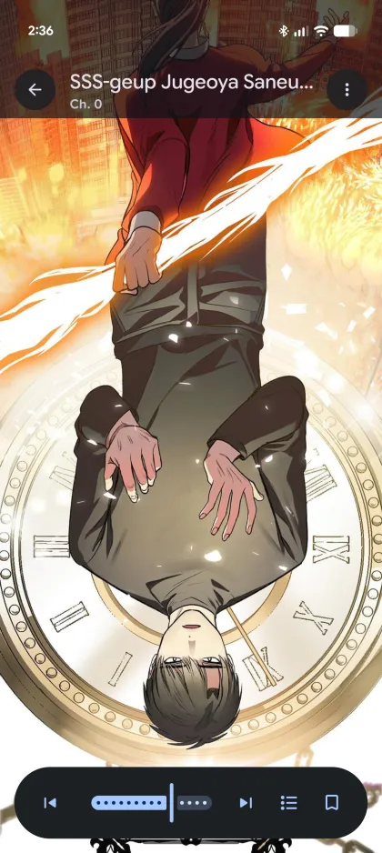
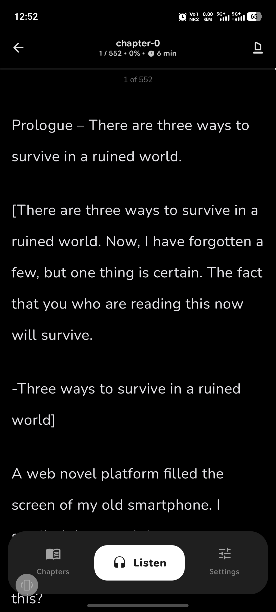
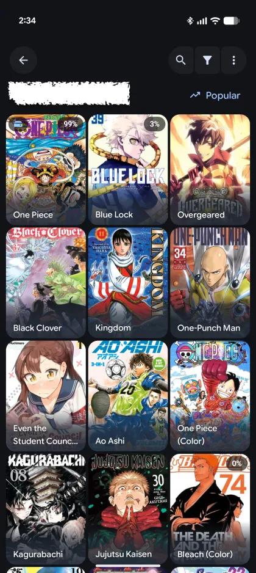
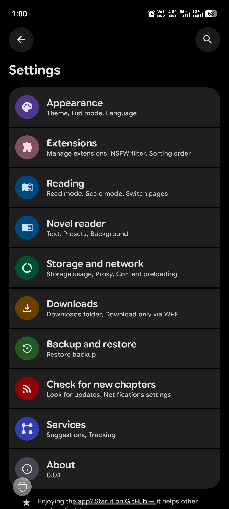

<h1 align="center">DeepSync</h1>

<p align="center">
  One project, one app per platform: a manga, light-novel and anime reader with a full novel reader, text-to-speech, tracker sync and a Material 3 Expressive design.
</p>

<p align="center">
  
  
  
  
  <a href="LICENSE"></a>
</p>

<p align="center">
  <a href="https://github.com/Arthurpendragon9876/DeepSync"><strong>GitHub</strong></a>
  |
  <a href="https://github.com/Arthurpendragon9876/DeepSync/releases/latest"><strong>Latest release</strong></a>
  |
  <a href="CHANGELOG.md"><strong>Changelog</strong></a>
  |
  <a href="https://github.com/Arthurpendragon9876/DeepSync/issues"><strong>Issues</strong></a>
  |
  <a href="https://github.com/HuzaifaKhalid1311/DropSauce"><strong>Main branch (DropSauce)</strong></a>
</p>

---

## About

**DeepSync** is the project. Each platform gets its own app, with its own name:

| App | Platform | Status |
| --- | --- | --- |
| **Yugen** | Android | Available now (v0.1.0) |
| **Shinkai** | Linux | Coming soon |
| **Yomi** | Windows | Coming soon |

This repository currently holds **Yugen**, the Android app. Shinkai and Yomi will be released under the same DeepSync project.

Yugen is a fork of [DropSauce](https://github.com/HuzaifaKhalid1311/DropSauce) by HuzaifaKhalid1311, which is the **main branch** this project is built on. On top of it, Yugen adds:

- a rebuilt novel reader (scroll styles, presets, custom backgrounds, text-to-speech),
- a redesigned Home with banner styles, switchable carousels and a live layout preview,
- tracker matching that tells same-named titles apart, tracker details pages and a metadata source picker,
- Sync Library and tracker synchronization across AniList, MyAnimeList and MangaBaka,
- an anime watch page with notes, auto-picked streams and a Player settings page,
- a pulse touch feedback instead of ripples, and a new Yugen identity.

The Android app installs as `com.kotatsu.deepsync` (debug builds add `.debug`, preview builds `.preview`), so it sits next to DropSauce rather than replacing it. See the [changelog](CHANGELOG.md) for everything that changed since the 0.0.1 beta.

## Screenshots

<p align="center">
  
  
  
  
  
  
</p>

<p align="center">
  <sub>Favorites | Details | Manga/Webtoon Reader | Novel Reader | Extensions | Settings</sub>
</p>

## Highlights
- Manga, webtoon, light-novel and anime reading in one app, including offline EPUB importing.
- Multi-source extension engine supporting LNReader JS plugins and Tsundoku APK extensions.
- Tracking with AniList, MyAnimeList and MangaBaka: best-match linking, a merged Sync Library and automatic synchronization where the furthest progress wins.
- Material 3 Expressive design with a Home you can rearrange, and accent colours that follow your theme.
- local backup/restore and in-app updates, plus Kotatsu and Mihon backup restoration.
- Free and open-source under the GPLv3 license.

<details>
<summary><strong>Features</strong></summary>

- Comfortable manga, webtoon and novel reading with configurable reader behavior, haptics, zoom gestures and redesigned quick settings.
- EPUB novel importing for offline reading.
- Extensive extension ecosystem supporting native extensions, LNReader JS plugins and Tsundoku APK extensions.
- Anime watching with a YouTube-style watch page, per-anime notes, auto-pick stream and a dedicated Player settings page.
- Tracker integration with a tracking sheet, a status button on the details page and a progress editor.
- Tracker details pages with synopsis, alternative titles, characters, staff, relations and recommendations.
- Choose covers and info from the tracker or from the source.
- Favorites, history, bookmarks, tracking, stats and categories to keep your library organized.
- Mark as Completed, Not read or Not watched, also on linked trackers.
- NSFW mode, genre filters and incognito mode, including for anime.
- Home layout with banner styles, a switch for every carousel and a custom carousel from your Favourites categories.
- Mode button with tap, pull and hold gestures.
- Google Drive sync for library, history, bookmarks, tracking, stats, settings and covers.
- Local backup and restore system for moving or protecting your setup.
- Android widgets for continue reading, favorites and reading stats.
- PDF import support, converting PDFs into readable CBZ chapters.
- App lock with biometric or device credential support.
- Downloads for offline reading when a source supports it.
- In-app updates, with APKs also published through GitHub Releases.

</details>

## Install (Android)

1. Open the [latest GitHub release](https://github.com/Arthurpendragon9876/DeepSync/releases/latest).
2. Download the newest `Yugen` APK.
3. Install it on a compatible Android device.
4. Add your preferred source or extension repository, then start reading.

Android may ask you to allow installs from your browser or file manager. That is normal for APKs downloaded outside the Play Store.

Shinkai (Linux) and Yomi (Windows) are not released yet. Watch the repository to be notified when they are.

## FAQ

### What is the difference between DeepSync and Yugen?
> DeepSync is the project. Yugen is its Android app. The Linux app will be called Shinkai and the Windows app Yomi, and both will come out under DeepSync.

### Does Yugen include manga, novels or anime?
> No. Yugen does not include built-in content. Sources are provided through external libraries, JS plugins or repositories added by users.

### Is Yugen free?
> Yes. Yugen is free and open source under the GPLv3 license.

### How do updates work?
> Release APKs are published on GitHub Releases. Install the latest APK from the Releases page, or update from inside the app where in-app updates are available.

### Can I contribute?
> Yes. Pull requests for patches, fixes and new features are welcome.

## Project structure

```plaintext
app/src/main/
├── kotlin/org/koitharu/kotatsu/
│   ├── core/          # Shared database, network, parser, preferences, UI (including pulse touch feedback), and utility code
│   ├── main/          # App entry points, main activity, splash, mode button and app-level screens
│   ├── home/          # Home header, carousels, banner styles and Yugen preferences
│   ├── reader/        # Manga and novel reader UI and reading behavior
│   ├── details/       # Manga, novel and tracker details, chapters, metadata, and related services
│   ├── metadata/      # Tracker/source metadata matching and metadata source picker
│   ├── anime/         # Anime player, watch page, stream auto-pick and Player settings
│   ├── explore/       # Browse and discovery screens
│   ├── search/        # Search screens and search flows
│   ├── favourites/    # Favorites and library-facing flows
│   ├── history/       # Reading history and progress
│   ├── download/      # Offline downloads and download queue
│   ├── extensions/    # Extension browsing, JS plugins, and APK extension management
│   ├── lnreader/      # LNReader JS plugin integration
│   ├── mihon/         # Mihon & Tsundoku APK extension integration
│   ├── backup/        # Local backup and restore
│   ├── sync/          # Google Drive sync data, domain, UI, and workers
│   ├── scrobbling/    # Tracker integrations (AniList, MyAnimeList, MangaBaka), Sync Library and tracker sync
│   ├── widget/        # Android home screen widgets
│   └── settings/      # Settings screens and preferences
└── res/
    ├── drawable*/     # Icons, backgrounds, and app artwork
    ├── layout*/       # XML screens, widgets, and reusable layouts
    ├── mipmap*/       # Launcher icons
    ├── values*/       # Strings, colors, themes, and translations
    └── xml/           # Android XML configuration
```

## Releasing

Releases are built by the **Build and Release** workflow (Actions tab, *Run workflow*, enter a version such as `0.1.1`). The release notes come from the changelog files in this repository, not from git history:

1. Add a `## [x.y.z] - date` section to [`CHANGELOG.md`](CHANGELOG.md), or create `changelogs/vx.y.z.md`.
2. Push to the branch you will run the workflow on.
3. Run the workflow with the same version. It uses `changelogs/vx.y.z.md` first, then the matching `CHANGELOG.md` section, and only falls back to the git log if neither exists.

## Contribute

You can send a Pull Request for your patches, fixes, or new features here.

1. Fork the repository.
2. Create a focused branch for your change.
3. Build locally with `./gradlew :app:assembleDebug`.
4. Add a line to the unreleased section of `CHANGELOG.md` for user-visible changes.
5. Open a Pull Request with a short explanation of what changed.

Small fixes are welcome. Clear screenshots or short screen recordings are extra helpful for UI changes.

## Credits

DeepSync exists because of the work already done by the open-source Android manga reader community.

Special thanks to [DropSauce](https://github.com/HuzaifaKhalid1311/DropSauce) by HuzaifaKhalid1311, the main branch this project is built on, and to the original [Kotatsu](https://github.com/KotatsuApp/Kotatsu) developers, [LNReader](https://github.com/LNReader/lnreader) developers, and the [Mihon](https://github.com/mihonapp/mihon) developers/community for the ideas, code, source ecosystem, and long-running maintenance work that helped shape projects like this.

## License

[](http://www.gnu.org/licenses/gpl-3.0.en.html)

<div align="left">

All programs from the DeepSync project are free, open-source programs under the GPL license. You may copy, distribute, and modify the software as long as you keep track of changes/dates in the source files. Any modifications to the software, including code licensed under the GPL (via a compiler), must also be provided under the GPL license.

Yugen is a fork of DropSauce™ and keeps its GPLv3 license.

</div>

## Disclaimer

<div align="left">

The developer(s) of this application do not have any affiliation with the content providers available. If there is any content, it is provided by external libraries added or imported by users; the application itself does not include any built-in content.

</div>
