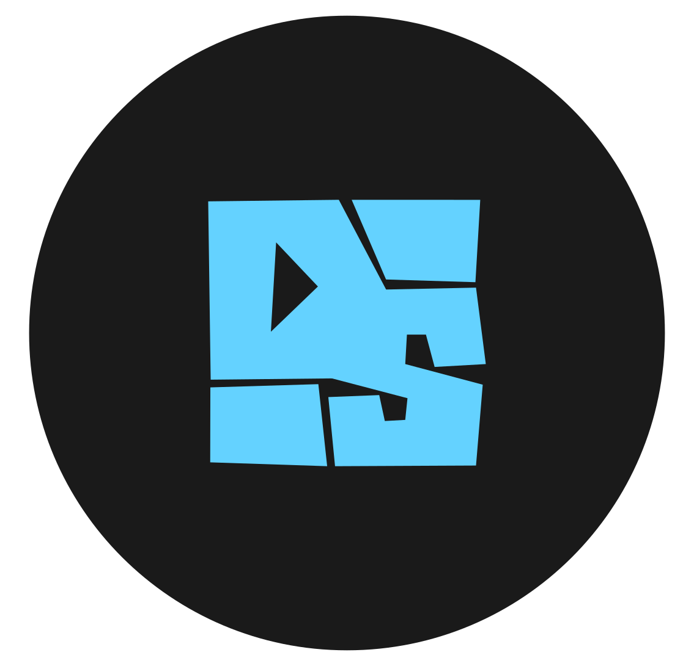
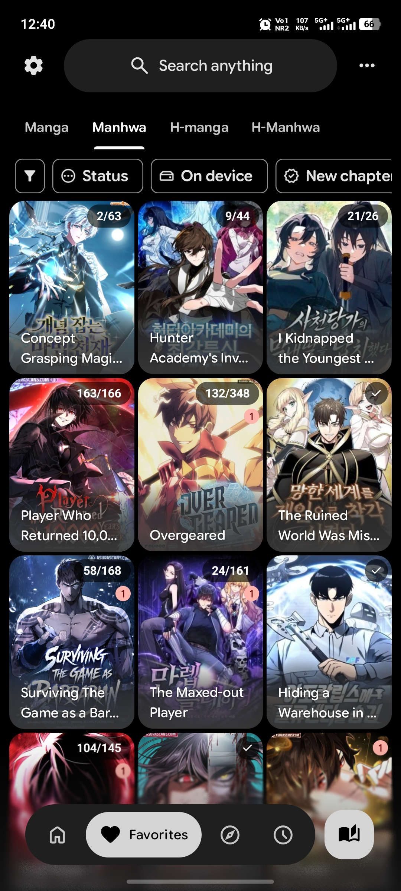
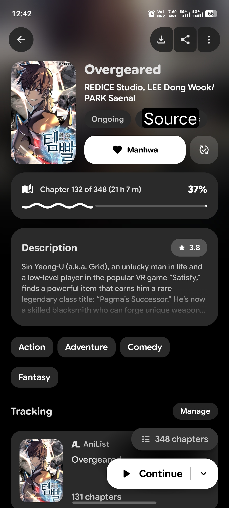
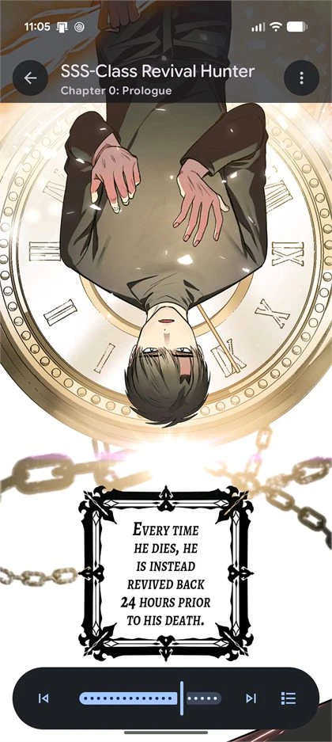
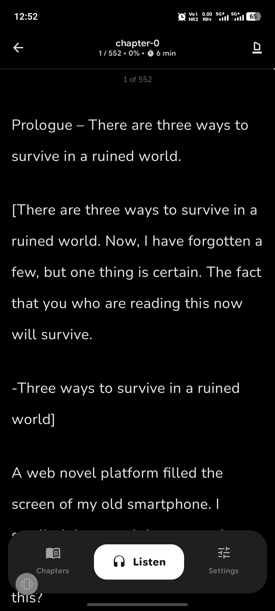
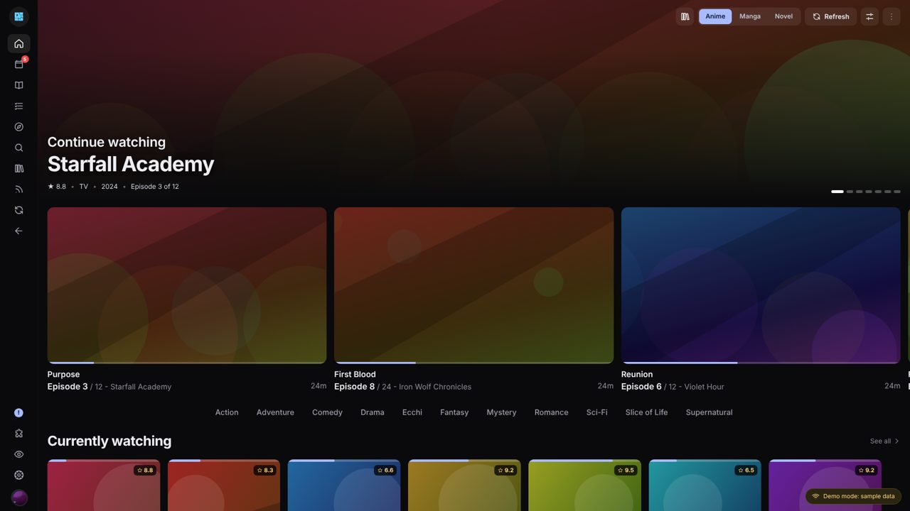
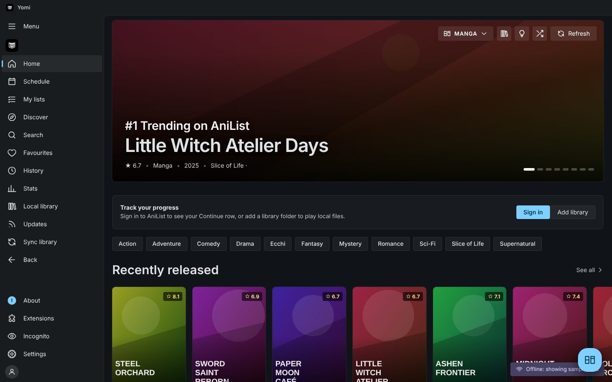

<p align="center">
  
</p>

<h1 align="center">DeepSync</h1>

<p align="center">
  One project, one app per platform: a manga, light-novel and anime reader with tracker sync (AniList, MyAnimeList, MangaBaka).<br />
  <strong>Yugen</strong> for Android, <strong>Shinkai</strong> for Linux, <strong>Yomi</strong> for Windows.
</p>

<p align="center">
  <a href="https://github.com/Arthurpendragon9876/DeepSync/releases?q=android-v&expanded=true"><strong>Android (Yugen)</strong></a>
  |
  <a href="https://github.com/Arthurpendragon9876/DeepSync/releases?q=shinkai-v&expanded=true"><strong>Linux (Shinkai)</strong></a>
  |
  <a href="https://github.com/Arthurpendragon9876/DeepSync/releases?q=yomi-v&expanded=true"><strong>Windows (Yomi)</strong></a>
  |
  <a href="https://discord.gg/ydkG7qAG3B"><strong>Discord</strong></a>
</p>

<p align="center">
  <a href="https://github.com/Arthurpendragon9876/DeepSync/releases"></a>
  <a href="https://github.com/Arthurpendragon9876/DeepSync/releases"></a>
  <a href="https://github.com/Arthurpendragon9876/DeepSync/stargazers"></a>
  <a href="https://discord.gg/ydkG7qAG3B"></a>
  <a href="LICENSE"></a>
</p>

<p align="center">
  <a href="https://github.com/Arthurpendragon9876/DeepSync/releases?q=android-v&expanded=true"></a>
  <a href="https://github.com/Arthurpendragon9876/DeepSync/releases?q=shinkai-v&expanded=true"></a>
  <a href="https://github.com/Arthurpendragon9876/DeepSync/releases?q=yomi-v&expanded=true"></a>
</p>

<p align="center">
  
  
  
  
  
</p>

## About

**DeepSync** is the project. Each platform gets its own app with its own name:

| App | Platform | Status | Download |
| --- | --- | --- | --- |
| [**Yugen**](android) | Android | Beta (stable 0.1.0 is also available) | [Releases](https://github.com/Arthurpendragon9876/DeepSync/releases?q=android-v&expanded=true) |
| [**Shinkai**](desktop/shinkai) | Linux | Beta | [Releases](https://github.com/Arthurpendragon9876/DeepSync/releases?q=shinkai-v&expanded=true) |
| [**Yomi**](desktop/yomi) | Windows | Beta | [Releases](https://github.com/Arthurpendragon9876/DeepSync/releases?q=yomi-v&expanded=true) |

All three are free and open source. None of them includes any content: sources come from extensions and repositories that you add yourself.

Please give the repo a star if you like the project. It helps more people find it.

## Screenshots

<p align="center">
  
  
  
  
</p>

<p align="center">
  <sub>Yugen (Android): Favorites | Details | Manga/Webtoon Reader | Novel Reader</sub>
</p>

<p align="center">
  
  
</p>

<p align="center">
  <sub>Shinkai (Linux) | Yomi (Windows)</sub>
</p>

## Highlights

- Manga, webtoon, light-novel and anime in one project, with the same Home layout, themes and tracker behaviour on every platform.
- Tracking with AniList, MyAnimeList and MangaBaka. Progress is never moved backwards, so syncing twice or from two devices is safe.
- **Yugen:** extension engine for Mihon, Tsundoku and Aniyomi APK extensions and LNReader JS plugins, EPUB import, Google Drive sync, local backup and restore (Kotatsu, Mihon and Anikku backups), widgets and app lock.
- **Shinkai:** Seanime-style layout, 13 colour themes (light and dark), local library scanner, built-in player or mpv, EPUB and manga readers.
- **Yomi:** Windows 11 look (Mica backdrop, native caption buttons), per-user installer with Java and the extension bridge bundled, taskbar progress, jump list and tray.
- Free and open source under the GPLv3 license.

<details>
<summary><strong>More about each app</strong></summary>

- **Yugen (Android):** full details, features and the project structure are in [`android/README.md`](android/README.md). The release history is in [`android/CHANGELOG.md`](android/CHANGELOG.md).
- **Shinkai (Linux):** [`desktop/shinkai/README.md`](desktop/shinkai/README.md) covers running from source, themes, packages and what each part does.
- **Yomi (Windows):** [`desktop/yomi/README.md`](desktop/yomi/README.md) covers the installer, the bundled Java runtime and the Windows-specific features.

</details>

## Install

### Android (Yugen)

1. Open the [Android releases](https://github.com/Arthurpendragon9876/DeepSync/releases?q=android-v&expanded=true) and download the newest `Yugen` APK. Releases marked **Pre-release** are betas.
2. Install it on an Android 8.0+ device. Android may ask you to allow installs from your browser or file manager. That is normal for APKs downloaded outside the Play Store.
3. Open **Explore > Manage**, add an extension repository, install the extensions you want and start reading.

### Linux (Shinkai)

1. Open the [Shinkai releases](https://github.com/Arthurpendragon9876/DeepSync/releases?q=shinkai-v&expanded=true) and pick a package:
   - **AppImage:** `chmod +x Shinkai-*.AppImage && ./Shinkai-*.AppImage`
   - **Arch / CachyOS:** `sudo pacman -U shinkai-*.pacman`
   - **Debian / Ubuntu:** `sudo apt install ./shinkai_*.deb`
   - **tar.gz:** unpack it anywhere and run the executable inside.
2. If the AppImage stops with a sandbox error on your distro, start it with `--no-sandbox`.

### Windows (Yomi)

1. Open the [Yomi releases](https://github.com/Arthurpendragon9876/DeepSync/releases?q=yomi-v&expanded=true) and download `Yomi-Setup-*.exe`.
2. Run it. The installer is per-user, so it does not ask for administrator rights. It is **unsigned**, so Windows SmartScreen may show a warning: choose **More info > Run anyway**.
3. Java and the extension bridge are inside the installer, so extensions work without installing anything else.

## Backups between apps

The Android app and the desktop apps use different backup formats for now. Favourites, categories and history can be moved from Android to Shinkai (for titles that are tracked with AniList), and progress stays in step through AniList itself. The details and the limits are in [docs/BACKUP.md](docs/BACKUP.md).

## Star History

<a href="https://www.star-history.com/?repos=Arthurpendragon9876%2FDeepSync&type=date&legend=top-left">
 <picture>
   <source media="(prefers-color-scheme: dark)" srcset="https://api.star-history.com/svg?repos=Arthurpendragon9876/DeepSync&type=Date&theme=dark" />
   <source media="(prefers-color-scheme: light)" srcset="https://api.star-history.com/svg?repos=Arthurpendragon9876/DeepSync&type=Date" />
   
 </picture>
</a>

## FAQ

### What is the difference between DeepSync, Yugen, Shinkai and Yomi?
> DeepSync is the project. Yugen is its Android app, Shinkai its Linux app and Yomi its Windows app.

### Do the apps include manga, novels or anime?
> No. They do not include any built-in content. Sources come from external extensions, plugins and repositories added by users.

### Are they free?
> Yes. All of them are free and open source under the GPLv3 license.

### How do updates work?
> Releases are published on GitHub, one per platform, tagged `android-v...`, `shinkai-v...` and `yomi-v...`. Download the newest one for your platform from the Releases page. Releases marked **Pre-release** are betas.

### Why does Windows warn me when I install Yomi?
> The installer is not code-signed yet. Choose **More info > Run anyway**.

### Can I contribute?
> Yes. Pull requests for patches, fixes and new features are welcome.

## Repository layout

```plaintext
DeepSync/
├── android/           # Yugen: the Android app (Kotlin, Jetpack Compose, Gradle)
├── desktop/
│   ├── shinkai/       # Linux app (Electron)
│   └── yomi/          # Windows app (Electron)
├── docs/              # Cross-app documentation (backups)
└── .github/workflows/ # One workflow per build: android-*, shinkai-linux, yomi-windows
```

## GitHub Actions

Each build has its own workflow and its own tag prefix, so releasing one never starts another.

| Workflow | When it runs | Output |
| --- | --- | --- |
| `android-preview.yml` | manually | preview APK artifact |
| `android-release.yml` | manually (enter a version such as `0.1.2-beta.1`) | GitHub release `android-v<version>` with the APK. A version with a suffix is published as a pre-release |
| `shinkai-linux.yml` | manually, or tag `shinkai-v*` | Linux packages as an artifact, pre-release on tag |
| `yomi-windows.yml` | manually, or tag `yomi-v*` | Windows installer as an artifact, release on tag |
| `backup-bridge-test.yml` | pull requests touching the backup converter | test run |

A Shinkai or Yomi tag must match the `version` in that app's `package.json`, or the build stops. For example: `git tag shinkai-v0.4.15 && git push origin shinkai-v0.4.15`.

## Contribute

1. Fork the repository.
2. Create a focused branch for your change.
3. Build the part you are changing: `cd android && ./gradlew :app:assembleDebug`, or `cd desktop/shinkai && npm ci && npm start` (the same in `desktop/yomi`).
4. For user-visible Android changes, add a line to the unreleased section of `android/CHANGELOG.md`.
5. Open a Pull Request with a short explanation of what changed.

Small fixes are welcome. Clear screenshots or short screen recordings are extra helpful for UI changes.

## Credits

DeepSync exists because of the work already done by the open-source Android manga reader community.

Special thanks to [DropSauce](https://github.com/HuzaifaKhalid1311/DropSauce) by HuzaifaKhalid1311, the main branch the Android app is built on, and to the original [Kotatsu](https://github.com/KotatsuApp/Kotatsu) developers, the [LNReader](https://github.com/LNReader/lnreader) developers and the [Mihon](https://github.com/mihonapp/mihon) developers and community for the ideas, code, source ecosystem and long-running maintenance work that helped shape projects like this.

## License

[](http://www.gnu.org/licenses/gpl-3.0.en.html)

All programs from the DeepSync project are free, open-source programs under the GPL license. You may copy, distribute, and modify the software as long as you keep track of changes/dates in the source files. Any modifications to the software, including code licensed under the GPL (via a compiler), must also be provided under the GPL license.

## Disclaimer

The developer(s) of this application do not have any affiliation with the content providers available. If there is any content, it is provided by external libraries added or imported by users; the applications themselves do not include any built-in content.
