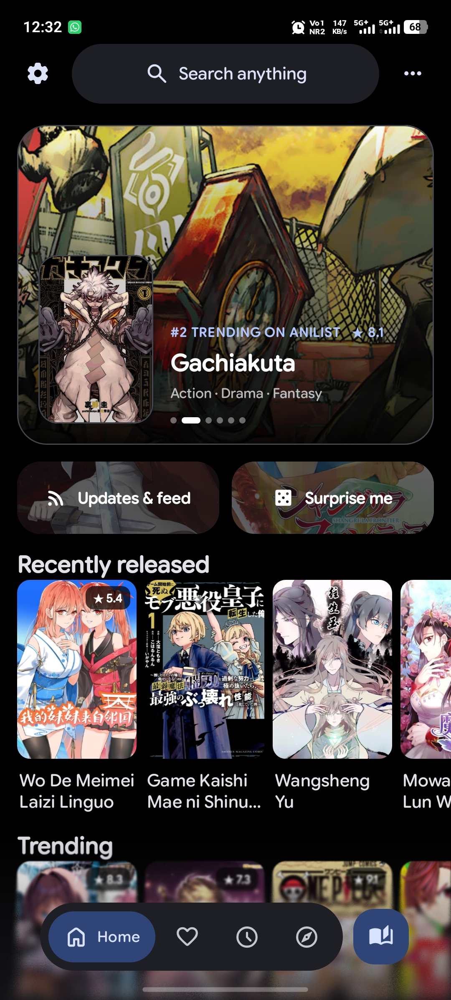
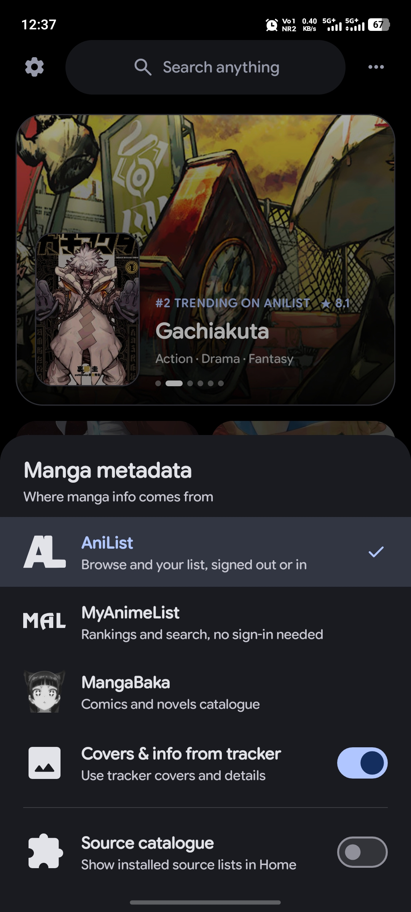
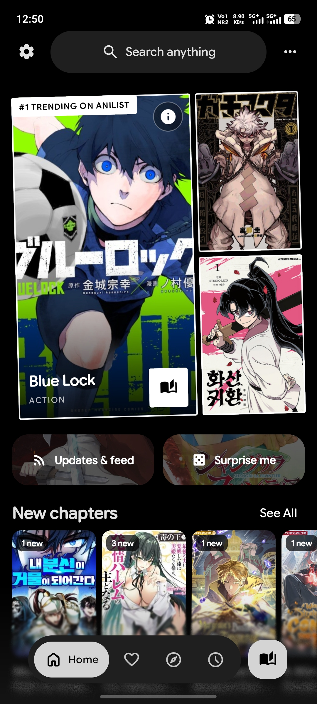
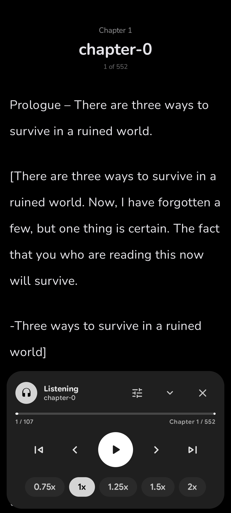
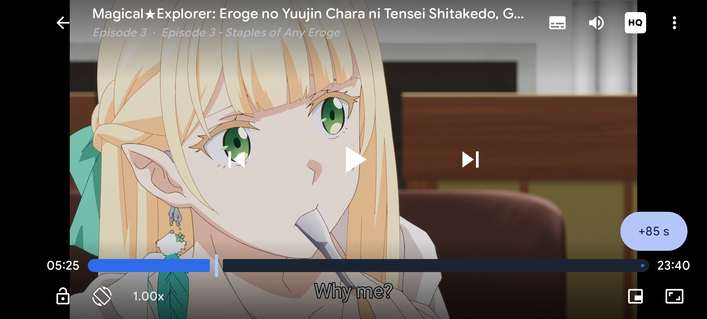
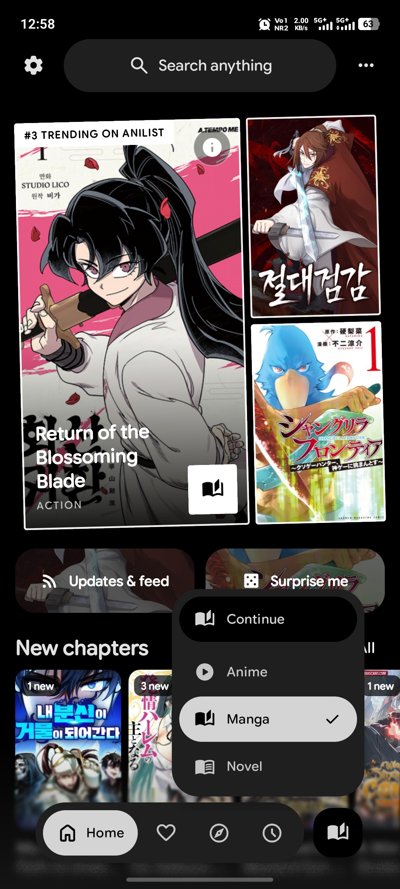

<p align="center">
  
</p>

<h1 align="center">DeepSync</h1>

<p align="center">
  A manga, light-novel and anime reader for Android with a full novel reader, text-to-speech, tracker-powered Home and a Material 3 Expressive design. Supports Mihon, Aniyomi and LNReader extensions.
</p>

<p align="center">
  <a href="https://github.com/Arthurpendragon9876/DeepSync/releases/latest"><strong>Download APK</strong></a>
  &nbsp;|&nbsp;
  <a href="https://github.com/Arthurpendragon9876/DeepSync/issues"><strong>Report a bug</strong></a>
  &nbsp;|&nbsp;
  <a href="https://github.com/HuzaifaKhalid1311/DropSauce"><strong>Based on DropSauce</strong></a>
</p>

<p align="center">
  <a href="https://github.com/Arthurpendragon9876/DeepSync/releases/latest"></a>
  <a href="https://github.com/Arthurpendragon9876/DeepSync/releases"></a>
  <a href="https://github.com/Arthurpendragon9876/DeepSync/issues"></a>
  <a href="LICENSE"></a>
</p>

<p align="center">
  
  <a href="https://developer.android.com/"></a>
  <a href="https://kotlinlang.org/"></a>
  <a href="https://developer.android.com/compose"></a>
  <a href="https://m3.material.io/"></a>
</p>

---

## About

DeepSync is a free and open-source reader for **manga, light novels and anime** on Android. It is a fork of [DropSauce](https://github.com/HuzaifaKhalid1311/DropSauce) by HuzaifaKhalid1311, which is the main branch this project is built on.

On top of DropSauce, DeepSync adds:

- A **rebuilt novel reader** with scroll styles, presets, custom backgrounds and text-to-speech.
- An **anime player** and Aniyomi extension support, managed from the same extension catalogue as manga and novels.
- A **redesigned Home** with banner styles, driven by AniList, MyAnimeList, MangaBaka or your own installed sources.
- A smarter tracker prompt, plus **mark as unread / unwatched** that keeps your trackers in sync.

DeepSync installs as `com.kotatsu.deepsync` (debug builds add `.debug`, preview builds `.preview`), so it sits **next to DropSauce** instead of replacing it.

> **Beta notice:** DeepSync is in beta (v0.0.1), so expect rough edges. Bug reports on GitHub are very welcome. See [Known issues](#known-issues).

## Screenshots

<p align="center">
  
  
  
  
  
  
  
  
  
  
  
  
</p>

<p align="center">
  <sub>Home Banner | Metadata Picker | Favorites | Details | Tracker Details | Manga/Webtoon Reader | Novel Reader | Listen (TTS) | Anime Player | Extensions | Global Search | Settings</sub>
</p>

## Highlights

- **Three modes, one app.** Manga, Novels and Anime each have their own Home, search and library flow. Double-tap the mode button next to the nav bar to jump between them.
- **Full novel reader** with presets, themes, typography controls, offline EPUB import and a built-in Listen (text-to-speech) player.
- **Tracker-powered Home.** Choose AniList, MyAnimeList or MangaBaka for rows, search and details, or switch to the Source catalogue to show what your installed sources offer.
- **Extension ecosystem.** Mihon and Tsundoku APK extensions, LNReader JS plugins and Aniyomi anime extensions, installed from shared extension stores.
- **Tracking that stays honest.** Progress syncs to your trackers, and marking a title unread or unwatched resets it on the trackers too.
- **Sync and backup.** Google Drive sync, local backup and restore, and restore from Kotatsu and Mihon backups.
- Free and open-source under the GPLv3 license.

<details>
<summary><strong>What's new in Beta v5</strong></summary>

- Metadata providers (AniList, MyAnimeList, MangaBaka) for Home, search and details, plus a separate Source catalogue toggle.
- Details pages can show a tracker's cover, banner, synopsis, genres and score.
- Choose a source and search inside it when a tracker title has no automatic match. Your pairing is remembered.
- Anime, Manga and Novel tabs in the extension catalogue. Anime extensions now install from the shared stores without a system installer prompt.
- Anime player remembers your server choice and asks again if the next episode does not offer it.
- Global search follows the current mode and can include tracker catalogues.
- Mark as unread / unwatched from Favourites and History, with tracker reset.
- Swipeable, endless Home banner and spotlight.
- Minimise the novel Listen panel to a small button while audio keeps playing.
- Fixes for release-build crashes, novels filed under Manga, empty Home rows and empty details pages.

See the full [release notes](https://github.com/Arthurpendragon9876/DeepSync/releases/latest).

</details>

<details>
<summary><strong>Features</strong></summary>

**Reading**
- Comfortable manga, webtoon and novel reading with configurable reader behaviour, haptics and zoom gestures.
- Novel reader with Presets / Text / Layout / Theme / Options settings, extra themes (Sepia, Dusk, Forest), letter spacing, paragraph indent, hyphenation and column width.
- Listen player with sentence highlighting, voice selection, speed and pitch, follow-reading, auto-continue to the next chapter and a sleep timer.
- EPUB importing for offline reading and PDF import that converts PDFs into readable CBZ chapters.
- Downloads for offline reading when a source supports it.

**Anime**
- Built-in anime player with server selection that carries over between episodes.
- Watching, Re-watching and episode wording across tracker screens.

**Discovery and library**
- Home rows from AniList, MyAnimeList, MangaBaka or your installed sources.
- Global search for the current mode, optionally including tracker catalogues.
- Favorites, history, bookmarks, categories and stats to keep your library organised.
- Mark as read / unread and watched / unwatched.

**Extensions**
- Native sources, LNReader JS plugins, Tsundoku APK extensions and Aniyomi anime extensions.
- Shared extension stores with Anime / Manga / Novel tabs, update support and an extension search box.

**Tracking, sync and system**
- Reverse tracking with a redesigned tracking menu.
- Google Drive sync for library, history, bookmarks, tracking, stats, settings and covers.
- Local backup and restore.
- Android widgets for continue reading, favorites and reading stats.
- App lock with biometric or device credential support.
- Material 3 Expressive details page.
- In-app updates, with APKs also published through GitHub Releases.

</details>

## Install

1. Open the [latest GitHub release](https://github.com/Arthurpendragon9876/DeepSync/releases/latest).
2. Download the newest `DeepSync` APK.
3. Install it on a device running **Android 8.0 or newer**.
4. Add an extension repository or plugin from the Extensions screen, then start reading or watching.

Android may ask you to allow installs from your browser or file manager. That is normal for APKs downloaded outside the Play Store.

## Known issues

- Pressing the volume keys can still cause crashes in the reader.
- This is an early beta. If something else breaks, please [open an issue](https://github.com/Arthurpendragon9876/DeepSync/issues) with your device, Android version and steps to reproduce.

## FAQ

### Does DeepSync include manga, novels or anime?
> No. DeepSync does not include built-in content. Sources come from external libraries, JS plugins and extension repositories that you add yourself.

### Is DeepSync free?
> Yes. DeepSync is free and open source under the GPLv3 license.

### Can I use it alongside DropSauce?
> Yes. DeepSync uses its own app id (`com.kotatsu.deepsync`), so both apps can be installed at the same time.

### Which trackers are supported?
> AniList, MyAnimeList and MangaBaka can supply Home, search and details. Reading and watching progress syncs to your signed-in trackers. MyAnimeList browsing works without signing in.

### How do updates work?
> DeepSync supports in-app updates, and release APKs are also published on GitHub. You can update from inside the app or install the latest APK from the Releases page.

### Can I contribute?
> Yes. Pull requests for patches, fixes and new features are welcome.

## Project structure

```plaintext
app/src/main/
├── kotlin/org/koitharu/kotatsu/
│   ├── core/            # Shared database, network, parser, preferences, UI, and utility code
│   ├── main/            # App entry points, main activity, floating nav bar
│   ├── home/            # Home rows, banner styles, mode switching
│   ├── metadata/        # Tracker metadata, source chooser, title-to-source pairing
│   ├── reader/          # Manga reader and the novel reader (chrome, TTS, themes)
│   ├── anime/           # Anime extensions, player, stream handling
│   ├── details/         # Details pages, chapters and tracker metadata overlay
│   ├── explore/         # Browse and discovery
│   ├── search/          # Global search (follows the current mode)
│   ├── favourites/      # Favorites and library flows
│   ├── history/         # Reading history, progress and mark as unread
│   ├── download/        # Offline downloads and download queue
│   ├── extensions/      # Extension browsing and plugin management
│   ├── lnreader/        # LNReader JS plugin integration
│   ├── mihon/           # Mihon and Tsundoku APK extension integration
│   ├── scrobbling/      # AniList, MyAnimeList, MangaBaka and other trackers
│   ├── backup/          # Local backup and restore
│   ├── sync/            # Sync data, domain, UI and workers
│   ├── widget/          # Android home screen widgets
│   └── settings/        # Settings, including the extension store catalogue
└── res/
    ├── drawable*/       # Icons, backgrounds and app artwork
    ├── layout*/         # XML screens, widgets and reusable layouts
    ├── values*/         # Strings, colors, themes and translations
    └── xml/             # Android XML configuration
```

## Contribute

You can send a Pull Request for your patches, fixes or new features.

1. Fork the repository.
2. Create a focused branch for your change.
3. Build locally with `./gradlew :app:assembleDebug`.
4. Open a Pull Request with a short explanation of what changed.

Small fixes are welcome. Clear screenshots or short screen recordings are extra helpful for UI changes.

## Credits

DeepSync stands on the work of the open-source Android reader community.

- [DropSauce](https://github.com/HuzaifaKhalid1311/DropSauce) by HuzaifaKhalid1311, the main branch this project is built on.
- [Kotatsu](https://github.com/KotatsuApp/Kotatsu), the original reader that DropSauce is based on.
- [Mihon](https://github.com/mihonapp/mihon) and [Aniyomi](https://github.com/aniyomiorg/aniyomi) for the extension ecosystem.
- [LNReader](https://github.com/LNReader/lnreader) for the JS plugin ecosystem.
- Novery (emptycastle, GPL-3.0), whose features and presets informed the novel reader. Bundled fonts keep their own open-source licences, mostly SIL OFL 1.1.

## License

[](http://www.gnu.org/licenses/gpl-3.0.en.html)

<div align="left">

DeepSync is free, open-source software under the GPL license. You may copy, distribute and modify the software as long as you keep track of changes and dates in the source files. Any modifications to the software, including code licensed under the GPL (via a compiler), must also be provided under the GPL license.

</div>

## Disclaimer

<div align="left">

The developer(s) of this application do not have any affiliation with the content providers available. If there is any content, it is provided by external libraries added or imported by users; the application itself does not include any built-in content.

</div>
