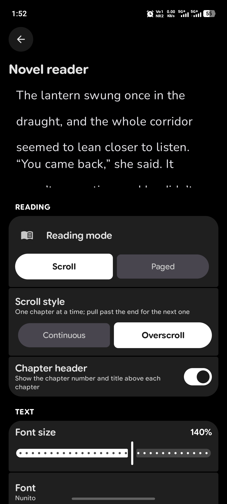

<h1 align="center">DeepSync</h1>

<p align="center">
  A manga, light-novel and anime reader for Android with a full novel reader, text-to-speech, tracker sync and a Material 3 Expressive design.
</p>

<p align="center">
  
  
  
  <a href="LICENSE"></a>
</p>

<p align="center">
  <a href="https://github.com/Arthurpendragon9876/DeepSync"><strong>GitHub</strong></a>
  |
  <a href="https://github.com/Arthurpendragon9876/DeepSync/releases"><strong>Releases</strong></a>
  |
  <a href="https://github.com/Arthurpendragon9876/DeepSync/issues"><strong>Issues</strong></a>
  |
  <a href="https://github.com/HuzaifaKhalid1311/DropSauce"><strong>Main branch (DropSauce)</strong></a>
</p>

---

## About

DeepSync is in **beta (v0.0.1)**, so expect rough edges. Bug reports on GitHub are very welcome.

It is a fork of [DropSauce](https://github.com/HuzaifaKhalid1311/DropSauce) by HuzaifaKhalid1311, which is the **main branch** this project is built on (itself built on [Kotatsu](https://github.com/KotatsuApp/Kotatsu)). DeepSync adds:

- a rebuilt **novel reader** (scroll styles, presets, typography, custom themes, text-to-speech),
- a redesigned **Home** with manga / novel / anime modes and three banner styles,
- a **metadata picker** that can take covers and info from AniList, MyAnimeList or MangaBaka,
- **type-aware tracker matching**, so a manhwa and a Boys' Love manga with the same name are no longer confused,
- an **anime player** with stream picking,
- more trackers, including MangaBaka and Discord rich presence.

The app installs as `com.kotatsu.deepsync` (debug builds add `.debug`, preview builds `.preview`), so it sits next to DropSauce rather than replacing it.

## Screenshots

<p align="center">
  
  
  
  
  
  
</p>

<p align="center">
  <sub>Favorites | Details | Manga/Webtoon Reader | Novel Reader | Extensions | Settings</sub>
</p>

<!--
Add these once the screenshots are in /assets, then delete this comment.

<p align="center">
  
  
  
  
  
  
</p>

<p align="center">
  <sub>Home | Metadata picker | Tracker match | Novel settings | Listen (TTS) | Anime player</sub>
</p>
-->

## Highlights
- Manga, webtoon, light-novel and anime in one app, switchable from Home.
- Full novel reader with offline EPUB importing, presets, themes and text-to-speech.
- Multi-source extension engine supporting LNReader JS plugins and Tsundoku APK extensions.
- Tracker sync with AniList, MyAnimeList, MangaBaka, Kitsu and Shikimori, plus Discord rich presence.
- Google Drive sync, local backup/restore, and in-app updates.
- Restores Kotatsu and Mihon backups.
- Free and open-source under the GPLv3 license.

<details>
<summary><strong>Features</strong></summary>

**Reading**
- Manga, webtoon and novel reading with configurable reader behavior, haptics and zoom gestures.
- EPUB importing for offline novel reading, and PDF import that converts PDFs into readable CBZ chapters.
- Downloads for offline reading when a source supports it.

**Novel reader**
- Scroll or paged reading, with several scroll styles and a chapter header between chapters.
- Presets, typography controls (letter spacing, paragraph indent, hyphenation, column width), extra themes and bundled fonts.
- Listen mode: text-to-speech with voice choice, speed and pitch, sentence highlighting, follow-reading, auto-advance and a sleep timer.
- Interactive zoom gestures.

**Anime**
- Anime sources through an extension manager, a built-in player and a stream picker.

**Home and discovery**
- Home for manga, novels and anime, with Panels, Card and Spotlight banner styles.
- Trending and rankings from AniList, MyAnimeList or MangaBaka, or lists straight from your installed sources.
- Suggestions, search with a Manga/Novel toggle, and a redesigned filter menu.

**Metadata and tracking**
- Metadata picker: choose AniList, MyAnimeList, MangaBaka or your sources, and whether covers and info on a title's page come from the tracker or from the source.
- Tracked titles use the cover and info of the entry they are tracked as, on the tracker they are tracked on.
- Untracked titles are matched by every name (romaji, English, native, synonyms) and by type (manga, manhwa, manhua) and Boys' Love, so same-named titles are told apart.
- Tracker prompt and link sheet show each candidate's type next to its name, and auto-link skips namesakes of the wrong kind.
- Reverse tracking with a redesigned tracking menu.

**Library and data**
- Favorites, history, bookmarks, categories and reading stats.
- Google Drive sync for library, history, bookmarks, tracking, stats, settings and covers.
- Local backup and restore system.

**App**
- Material 3 Expressive design, including the details page.
- Onboarding/welcome flow with sync and restore setup.
- Android widgets for continue reading, favorites and reading stats.
- App lock with biometric or device credential support.
- In-app updates, with APKs also published through GitHub Releases.

</details>

<details>
<summary><strong>Recent improvements</strong></summary>

- Metadata picker with a tracker/source switch for covers and info.
- Type-aware matching between sources and trackers (manga, manhwa, manhua, Boys' Love), and exact-entry lookup for tracked titles.
- Rebuilt novel reader with presets, themes and text-to-speech.
- Home banner styles and a manga / novel / anime switch.
- Anime player with stream picking.
- MangaBaka tracker and Discord rich presence.
- Edge-case crash fixes and release build cleanups.

</details>

## Install

1. Open the [latest DeepSync release](https://github.com/Arthurpendragon9876/DeepSync/releases/latest).
2. Download the newest DeepSync APK.
3. Install it on a device running Android 8.0 or newer.
4. Add your preferred source or extension repository, then start reading.

Android may ask you to allow installs from your browser or file manager. That is normal for APKs downloaded outside the Play Store.

## FAQ

### Does DeepSync include manga, novels or anime?
> No. DeepSync does not include built-in content. Sources are provided through external libraries, JS plugins, or repositories added by users.

### Is DeepSync free?
> Yes. DeepSync is free and open source under the GPLv3 license.

### Can it run next to DropSauce or Kotatsu?
> Yes. DeepSync uses its own package name (`com.kotatsu.deepsync`), so it installs alongside them. You can bring your library over with a Kotatsu or Mihon backup.

### Why do my tracked titles show the tracker's cover?
> By default, covers and info come from the tracker a title is tracked on. Open the metadata sheet on Home and turn off **Covers & info from tracker** to use what the source provides instead.

### How do updates work?
> DeepSync supports in-app updates, and release APKs are also published on GitHub. You can update from inside the app or install the latest APK from the Releases page.

### Can I contribute?
> Yes. Pull requests for patches, fixes, and new features are welcome.

## Project structure

```plaintext
app/src/main/
├── kotlin/org/koitharu/kotatsu/
│   ├── core/          # Shared database, network, parser, preferences, UI, and utility code
│   ├── main/          # App entry points, main activity, and app-level screens
│   ├── home/          # Home screen, banner styles, and the metadata picker
│   ├── metadata/      # Tracker metadata lookup, matching, and cover/info sources
│   ├── reader/        # Manga and novel reader UI (EPUB reader, TTS, presets)
│   ├── details/       # Manga, novel and anime details, chapters, and related services
│   ├── anime/         # Anime extensions, player, and stream picker
│   ├── explore/       # Browse and discovery screens
│   ├── search/        # Search screens and search flows (with Manga/Novel toggle)
│   ├── suggestions/   # Suggested titles
│   ├── favourites/    # Favorites and library-facing flows
│   ├── history/       # Reading history and progress
│   ├── stats/         # Reading statistics
│   ├── download/      # Offline downloads and download queue
│   ├── extensions/    # Extension browsing, JS plugins, and APK extension management
│   ├── lnreader/      # LNReader JS plugin integration
│   ├── mihon/         # Mihon & Tsundoku APK extension integration
│   ├── backup/        # Local backup and restore
│   ├── sync/          # Google Drive sync data, domain, UI, and workers
│   ├── scrobbling/    # Trackers (AniList, MAL, MangaBaka, Kitsu, Shikimori) and Discord
│   ├── tracker/       # Update checking and reverse tracking
│   ├── widget/        # Android home screen widgets
│   └── settings/      # Settings screens and preferences
└── res/
    ├── drawable*/     # Icons, backgrounds, and app artwork
    ├── layout*/       # XML screens, widgets, and reusable layouts
    ├── mipmap*/       # Launcher icons
    ├── values*/       # Strings, colors, themes, and translations
    └── xml/           # Android XML configuration
```

## Contribute

You can send a Pull Request for your patches, fixes, or new features here.

1. Fork the repository.
2. Create a focused branch for your change.
3. Build locally with `./gradlew :app:assembleDebug`.
4. Open a Pull Request with a short explanation of what changed.

Small fixes are welcome. Clear screenshots or short screen recordings are extra helpful for UI changes.

## Credits

DeepSync exists because of the work already done by the open-source Android manga reader community.

Special thanks to [DropSauce](https://github.com/HuzaifaKhalid1311/DropSauce) (the main branch), the original [Kotatsu](https://github.com/KotatsuApp/Kotatsu) developers, [LNReader](https://github.com/LNReader/lnreader) developers, and the [Mihon](https://github.com/mihonapp/mihon) developers/community for the ideas, code, source ecosystem, and long-running maintenance work that helped shape projects like this.

The novel reader's features and presets are modelled on [Novery](https://github.com/emptycastle) (GPL-3.0). Fonts copied from Novery keep their own open-source licences (mostly SIL OFL 1.1).

## License

[](http://www.gnu.org/licenses/gpl-3.0.en.html)

<div align="left">

DeepSync is free, open-source software under the GPL license. You may copy, distribute, and modify the software as long as you keep track of changes/dates in the source files. Any modifications to the software, including code licensed under the GPL (via a compiler), must also be provided under the GPL license.

</div>

## Disclaimer

<div align="left">

The developer(s) of this application do not have any affiliation with the content providers available. If there is any content, it is provided by external libraries added or imported by users; the application itself does not include any built-in content.

</div>
