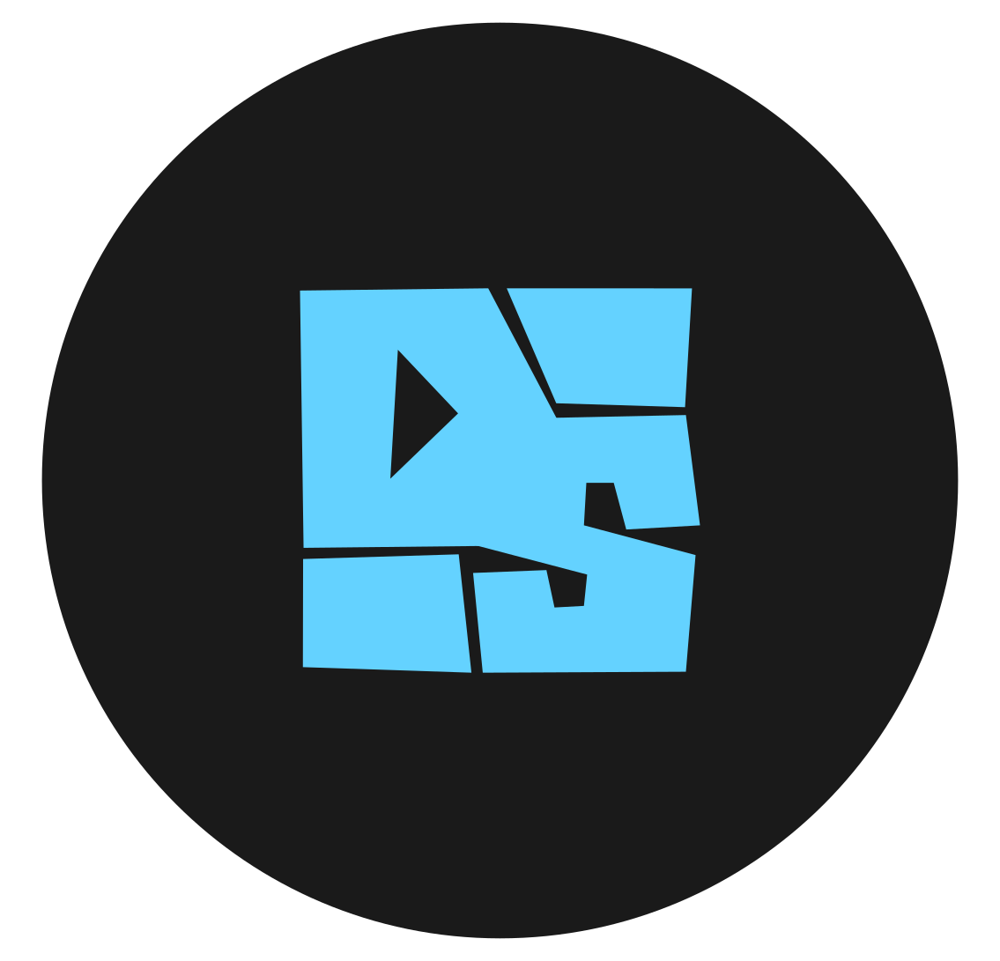
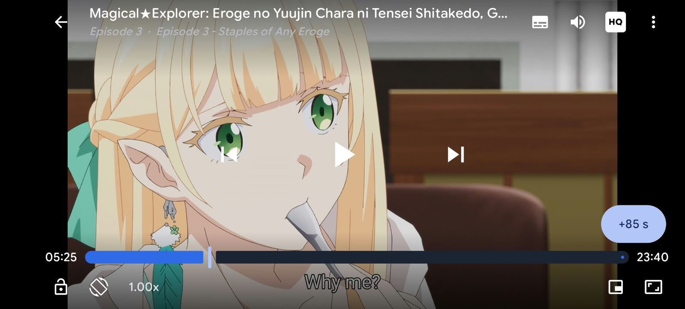
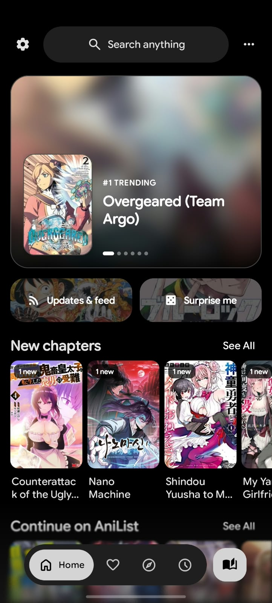
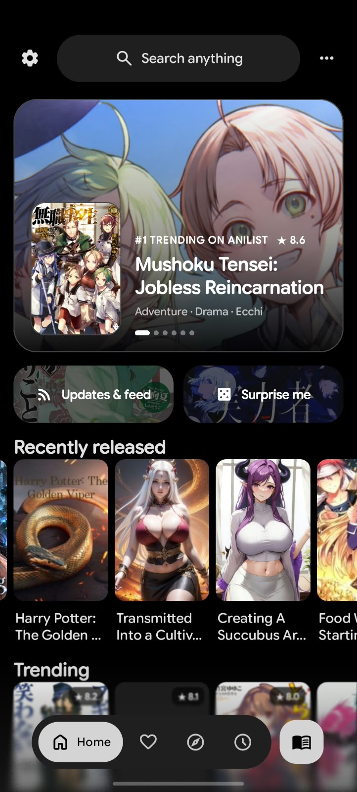
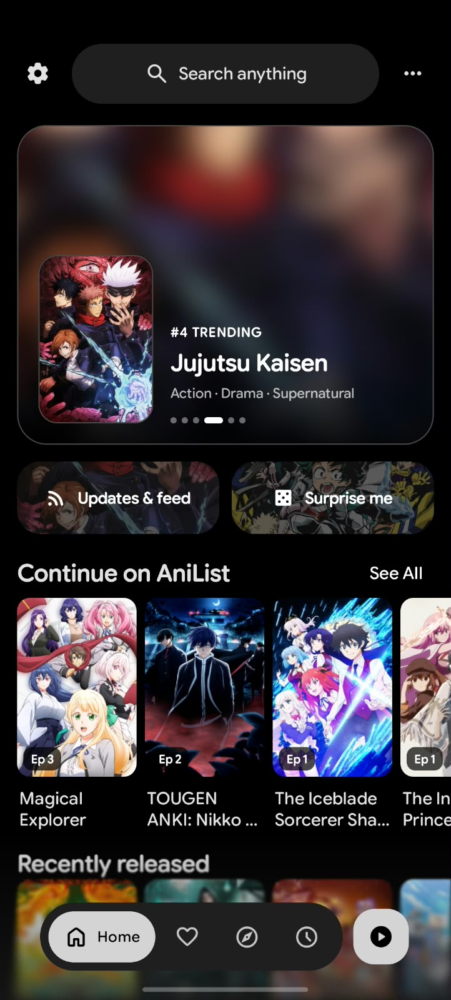
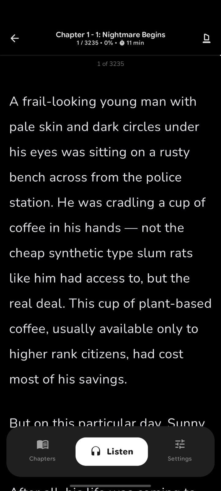
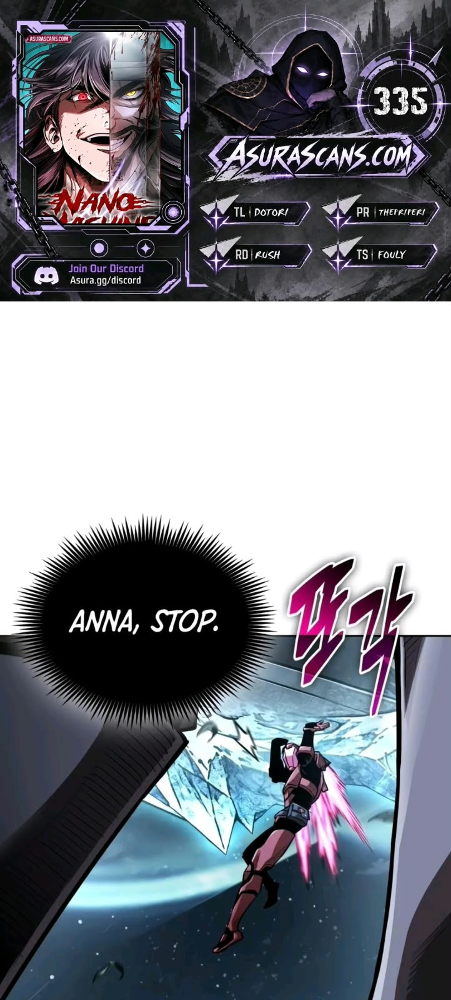
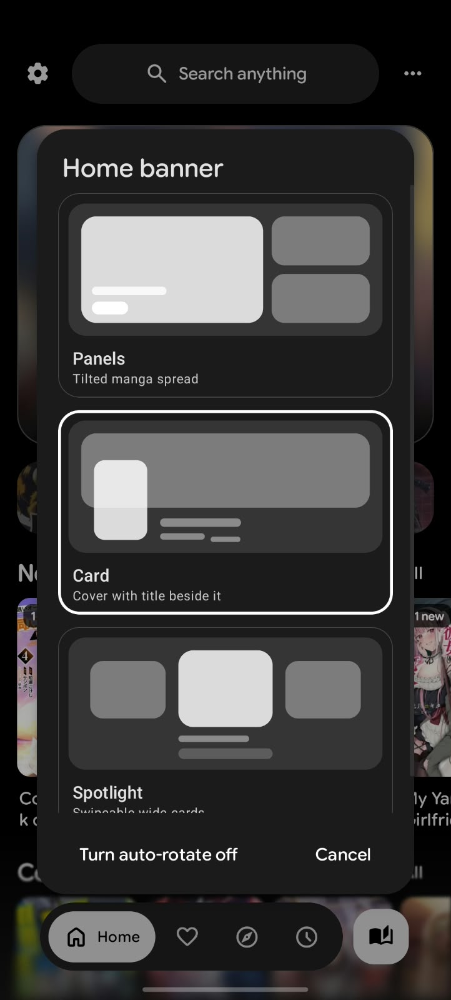

<p align="center">
  
</p>

<h1 align="center">DeepSync</h1>

<p align="center">
  An advanced, lightweight comic, novel, and anime streaming reader for Android with a beautiful Material 3 Expressive design. Enhanced with superior synchronization, anime support, and upgraded novel features (Beta).
</p>

<p align="center">
  <a href="https://github.com/Arthurpendragon9876/DeepSync/releases/latest"><strong>Download APK</strong></a>
</p>

<p align="center">
  <a href="https://github.com/Arthurpendragon9876/DeepSync/releases"></a>
  <a href="https://github.com/Arthurpendragon9876/DeepSync/releases"></a>
  <a href="LICENSE"></a>
</p>

<p align="center">
  <a href="https://developer.android.com/"></a>
  <a href="https://kotlinlang.org/"></a>
  <a href="https://developer.android.com/compose"></a>
  <a href="https://m3.material.io/"></a>
</p>

## Screenshots

<p align="center">
  
</p>
<p align="center">
  <sub>Landscape Anime Player</sub>
</p>

<p align="center">
  
  
  
  
  
  
</p>

<p align="center">
  <sub>Manga Home | Novel Home | Anime Home | Novel Reader | Webtoon Reader | Home Banner Customization</sub>
</p>

## Highlights
- **Full Anime Streaming Support:** Integrated anime viewing capabilities right alongside your manga and reading lists.
- **Enhanced Novel Engine:** Upgraded novel features featuring smoother layout rendering, offline EPUB file importing, and interactive zoom gestures.
- **Advanced Synchronization:** Superior sync architecture ensuring seamless tracking, library, and settings continuity.
- Multi-source extension engine supporting plugins and extensions.
- Lightweight Android-first experience with a polished, modern interface.
- Local backup/restore and optimized Google Drive sync.
- Free and open-source under the GPLv3 license.

<details>
<summary><strong>Features</strong></summary>

- Integrated anime streaming alongside manga, webtoon, and novel reading.
- Advanced novel reading experience with enhanced formatting, haptics, and zoom gestures.
- EPUB and PDF novel/book importing with conversion into readable chapters.
- Extensive extension ecosystem for sources and plugins.
- Reverse tracking integration with a redesigned tracking menu.
- Favorites, history, bookmarks, tracking, stats, and categories to keep your library organized.
- Highly optimized Google Drive sync and robust local backup/restore options.
- Material 3 Expressive layout design.
- App lock with biometric or device credential support.
- Downloads for offline usage when sources support it.

</details>

<details>
<summary><strong>Recent Beta improvements</strong></summary>

- Added native **Anime streaming support** and UI modules.
- Upgraded novel reader parsing, gesture handling, and offline EPUB capabilities.
- Overhauled synchronization pipeline for faster, more reliable multi-device backups.
- Added reverse tracking and refreshed tracking menu design.
- Redesigned list options, filter menu, and progress tracking.
- Minor UI improvements and edge-case bug fixes.

</details>

## Star History

<a href="https://www.star-history.com/?repos=Arthurpendragon9876%2FDeepSync&type=date&legend=top-left">
 <picture>
    <source media="(prefers-color-scheme: dark)" srcset="https://api.star-history.com/chart?repos=Arthurpendragon9876%2FDeepSync&type=date&theme=dark&legend=top-left" />
    <source media="(prefers-color-scheme: light)" srcset="https://api.star-history.com/chart?repos=Arthurpendragon9876%2FDeepSync&type=date&legend=top-left" />
    
  </picture>
</a>

## Install

1. Open the [latest GitHub release](https://github.com/Arthurpendragon9876/DeepSync/releases/latest).
2. Download the newest `DeepSync` APK.
3. Install it on a compatible Android device.
4. Add your preferred source or extension repository, then start streaming/reading.

Android may ask you to allow installs from your browser or file manager. That is normal for APKs downloaded outside the Play Store.

## FAQ

### Does DeepSync include media content?
> No. DeepSync does not include built-in content. Sources and streams are provided through external libraries, plugins, or repositories added by users.

### Is DeepSync free?
> Yes. DeepSync is free and open source under the GPLv3 license.

### How do updates work?
> Updates are published directly on the GitHub Releases page. You can check back and download the newest APK when updates are available.

### Can I contribute?
> Yes. Pull requests for patches, fixes, and new features are welcome.

## Project structure

```plaintext
app/src/main/
├── kotlin/org/koitharu/kotatsu/
│   ├── core/          # Shared database, network, parser, preferences, UI, and utility code
│   ├── main/          # App entry points, main activity, and app-level screens
│   ├── reader/        # Manga and novel reader UI and reading behavior
│   ├── anime/         # Custom anime streaming modules and player UI
│   ├── details/       # Media details, chapters, episodes, and metadata
│   ├── explore/       # Browse and discovery screens
│   ├── search/        # Search screens and search flows
│   ├── favourites/    # Favorites and library-facing flows
│   ├── history/       # Reading/watching history and progress
│   ├── download/      # Offline downloads and download queue
│   ├── extensions/    # Extension browsing and management
│   ├── lnreader/      # LNReader plugin integration
│   ├── backup/        # Local backup and restore
│   ├── sync/          # Advanced sync data, domain, UI, and workers
│   └── settings/      # Settings screens and preferences
└── res/
    ├── drawable*/     # Icons, backgrounds, and app artwork
    ├── layout*/       # XML screens, widgets, and reusable layouts
    ├── mipmap*/       # Launcher icons
    ├── values*/       # Strings, colors, themes, and translations
    └── xml/           # Android XML configuration

```

## Contribute

You can send a Pull Request for your patches, fixes, or new features here.

1. Fork the repository.
2. Create a focused branch for your change.
3. Build locally with `./gradlew :app:assembleDebug`.
4. Open a Pull Request with a short explanation of what changed.

## Credits

DeepSync builds upon the foundational work of the open-source Android reader community, including [Kotatsu](https://github.com/KotatsuApp/Kotatsu), [LNReader](https://github.com/LNReader/lnreader), and [Mihon](https://github.com/mihonapp/mihon).

## License

All programs from the DeepSync project are free, open-source programs under the GPL license.

## Disclaimer

The developer(s) of this application do not have any affiliation with the content providers available. Content is supplied entirely by external libraries or repositories added by users.

To update it on your repository, write this text to your local `README.md` file and run:

```bash
git add README.md
git commit -m "Update README: remove in-app update mention"
git push origin main

```
