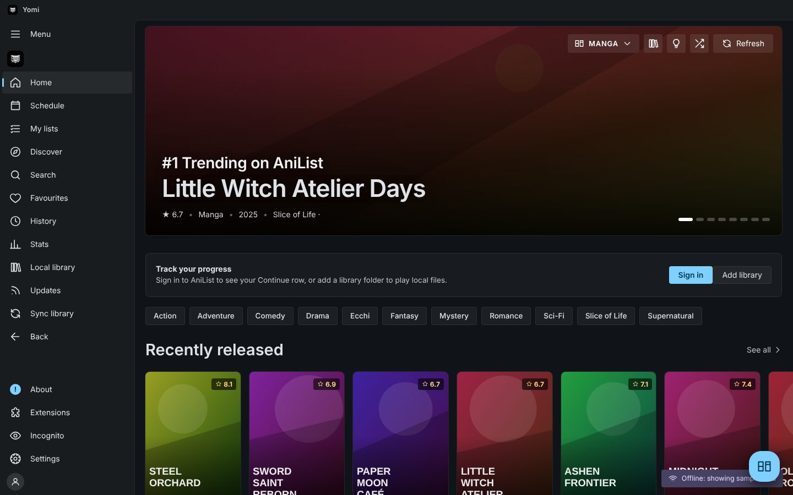

# Yomi (Windows)

Yomi is the Windows app of the **DeepSync** project: anime, manga and light novels with AniList sync, on the same Material colour themes as the
Android app (**DeepSync / Yugen**) but with a Windows 11 body: an expandable navigation pane, Mica backdrop, Segoe UI Variable, Fluent controls.
Its Linux sibling is **Shinkai**; both share the same engine and keep their own look. Built with Electron, no bundler.



## Run it

```bash
npm install
npm start                 # launches the Electron app (on Windows, or on Linux for a quick look)
npm run dev:web           # the UI in a browser at http://127.0.0.1:5173, no Electron needed
npm run dev:web:win       # same, but drawn as it is on Windows (title bar, Windows settings, Mica backdrop); handy from a Linux PC
npm test                  # unit tests for the main-process logic (Node 20+)
```

No network? The app falls back to built-in demo data automatically (or turn on **Settings > Content & privacy > Demo mode**).

## Build Yomi

### From your Linux PC (no Windows machine, no VM)

```bash
bash tools/build-yomi.sh --check     # is this PC ready? (changes nothing)
bash tools/build-yomi.sh             # -> dist/Yomi-Setup-<version>-x64.exe
bash tools/build-yomi.sh --zip       # also a portable zip: unzip anywhere, run Yomi.exe
```

- Needs **Node 20+** and internet **on the first run only** (Electron, the NSIS installer maker and the Java runtime, about 300 MB, are cached afterwards).
- **wine is optional.** It is only used to stamp Yomi's icon and version into `Yomi.exe`. Without it the installer still builds and works, the window and taskbar show the
  Yomi icon, but the `.exe` file itself keeps Electron's icon. `sudo pacman -S wine` (Arch) or `sudo apt install wine64` (Debian/Ubuntu) enables it; 32-bit wine is not needed.
- `--no-brand` skips the wine step, `--brand` insists on it, `--clean` wipes `dist/`, `--dry-run` prints every command without running it.
- Copy the `.exe` to a Windows PC and run it. It is **unsigned**, so SmartScreen shows *More info > Run anyway* until you sign it (set `CSC_LINK` / `CSC_KEY_PASSWORD`).
- Auto-update is off unless you build with `YOMI_UPDATE_URL=<folder that holds latest.yml>`.

### On Windows

```bat
npm install
npm run dist:win          :: dist\Yomi-Setup-<version>-x64.exe
```

A GitHub Actions workflow (`.github/workflows/build-windows.yml`) does the same on `windows-latest` for every `v*` tag.

## What makes it Windows

| Area | What it does |
| --- | --- |
| Installer | One-click per-user NSIS installer (no admin prompt), Start menu + desktop shortcut, uninstall keeps your data. Associates **.cbz** and **.epub** (Open with…) and the `aniyomi://` link. |
| Java | A Temurin 17 JRE and the extension bridge are **inside the installer** (`resources/java`, `resources/bridge`), so extensions work with no Java install. If they are missing (dev run) Yomi finds a system Java (Program Files, JAVA_HOME, PATH) or downloads the JRE zip itself. `java.exe` runs without a console window. |
| Window | Native caption buttons (Snap Layouts on the maximise button), **Mica / Acrylic / Mica Alt** on Windows 11 22H2+, solid on Windows 10 or when transparency is off in Windows personalisation. The caption buttons, Mica fallback colour and system menus follow the app's **Dark / Light / System** choice. Optional Windows accent colour. Window position is remembered and kept inside the work area. |
| Taskbar | Progress on the taskbar button for library scans and the Java/bridge download, a jump list (Local library, Extensions, Settings, five recent titles), tray icon with close-to-tray / minimise-to-tray, optional start with Windows. |
| Notifications | Windows toasts for scan finished, runtime ready/failed and updates, only while Yomi is in the background. Focus Assist applies. |
| Updates | `electron-updater` with differential downloads and a silent install on exit. Off unless you build with `YOMI_UPDATE_URL`. |
| Performance | Off-screen grid cards skip layout/paint (`content-visibility`), animations only use `transform`/`opacity`, `prefers-reduced-motion` is honoured, HEVC hardware decode is requested. |
| Details | System volume keys use Windows media keys (2 % per step, default scope is *Player only*), mpv is looked up in the usual Windows folders (or `resources/mpv`), speech uses Windows voices. Settings > Windows holds the switches. |

ARM64 PCs run the x64 build under emulation.

## Look and themes

The colours are the Android app's own palettes: **13 themes x light/dark**, in `renderer/css/theme.css`. Yomi defaults to **Sky** and **follows Windows' light/dark setting**.
Pick the theme, **Dark / Light / System** and **AMOLED black** under Settings > Appearance. *Use Windows accent colour* (Settings > Windows) still overrides the theme's accent.

The shapes are Windows' (`renderer/css/yomi.css`): 4 px controls, 8 px cards and covers with the title under the cover, an accent indicator bar on the selected item,
underline tabs, Fluent text boxes and toggles, Windows 11 Settings-style cards. The menu button expands the navigation pane to show labels (remembered).
`css/app.css` holds the layout; Android's wallpaper-based "Expressive" theme has no desktop equivalent.

## Name, data and startup screen

The app is **Yomi**; *DeepSync* is the project it belongs to (the Android app is Yugen). Internal identifiers (`deepsync://` protocol, `DEEPSYNC_*` test variables) keep the project name on purpose.
If `%APPDATA%\DeepSync` exists from an earlier build, Yomi keeps using it instead of creating `%APPDATA%\Yomi`, so settings, library links and logins carry over.

On launch Yomi shows a short splash: the logo eases in, the name fades up letter by letter and the **O is a progress ring** that spins while the app loads and closes when it is ready.
Press any key or click to skip it. Turn it off in Settings > Appearance > *Startup animation*; it is also skipped when Windows' "Show animations" is off.

## What it does

| Area | Details |
| --- | --- |
| Home (Yugen) | Spotlight / Card / Panels banner, Continue cards, genre links, Currently watching, Local library, Recently released, Trending, Popular. Anime / Manga / Novel switch. Every row can be switched off. |
| Trackers | AniList: sign in with a token, lists, status/progress/score editing, automatic progress when you finish an episode or chapter (never moves backwards). Incognito mode skips all saving. |
| Discover / Search | AniList browse and filters (genre, format, status, sort) for anime, manga and novels. Weekly airing Schedule, Updates feed. |
| Local library | Scans folders: anime video files, manga `.cbz`/`.zip` or image folders, novels `.epub`. Auto-matches titles to AniList; you can relink manually. |
| Readers | Manga: webtoon, paged and paged-RTL with keyboard control. Novels: EPUB reader with contents, themes, font and spacing. Video: built-in player with resume, or **Open in mpv**. |
| Online manga | MangaDex source (English chapters) in the Chapters sheet. |
| Data | Backup export/import (tokens are never exported), cache clearing. |

### AniList sign-in
1. Create a client at https://anilist.co/settings/developer with redirect URL `https://anilist.co/api/v2/oauth/pin`.
2. Settings > Trackers: enter the client ID, click **Open AniList login**, approve, paste the token shown, **Connect**.

## New in 0.3.0 (Yugen parity)

- **Source linked on open.** Opening a title resolves its source immediately: the saved link first, otherwise your installed sources are searched with the
  same matcher as Android (threshold 0.85) and the best match is saved. The chip beside the status (e.g. *Asura Scans*) shows it; click it to change the
  source, search for a different series, re-run the automatic match or unlink. Chapters/episodes load in place on the page, and **Continue** opens the next one directly.
- **Details page** now mirrors Android: source chip, list-status button, wavy progress card (`Chapter 132 of 348 (~18 h left) 37%`), description with score,
  info grid, alternative titles, inline chapter list (filter + sort, mark read up to here) and a floating **Continue** split button.
- **YouTube-style anime page** (Settings > Appearance > *Anime page layout*; default on): player on top with the "Waiting for Episode to be picked" state,
  title/action row, description chips, timestamped **Notes & Annotations**, and the episode list in a sidebar. Keys: `K`/Space, `J`/`L` ±10 s, `N`/`P`, `F` and more. Every player key can be remapped in **Settings → Player → Keyboard shortcuts**; the full-screen player and this page share one key map.
- **Manga quick settings** (`S` or the sliders button): Standard / R-to-L / Vertical / Webtoon, automatic scroll, save page, fullscreen, colour correction
  (brightness, contrast, sepia, invert, grayscale), page gaps, fit, width, background, tap-zone inversion, chapter jump, bookmarks. Remembered per manga.
- **Novel quick settings + reader**: header `3 / 520 • 12% • 8 min`, bottom bar *Chapters / Listen / Settings*, theme, font, size, line and paragraph spacing,
  width, justify, bionic reading, automatic scroll, and **Listen** (text to speech with voice and speed).
- Novels still read local EPUBs only; online novel sources (LNReader plugins) are not ported yet.

## Project layout

```
main/            Electron main process (plain Node, tested)
  api.js         every operation the UI can call (Electron-free, so tests and the dev server reuse it)
  anilist.js     GraphQL client       scanner.js / zip.js / epub.js   local library
  win/           the Windows layer: Mica, caption buttons, tray, jump list, toasts, updates, theme sync
  main.js        window, deepsync:// protocol (static files, ranged media, zip entries), IPC
  extensions/    Aniyomi/Mihon extension support (see below)
renderer/        UI: ES modules, no framework. css/theme.css (palettes), app.css (layout), yomi.css (Windows look), splash.css
tools/           build-yomi.sh (Linux build), fetch-win-runtime.js, dev-server.js (browser harness)     test/   unit tests
```

## Aniyomi / Mihon extensions

Extension APKs are Android code, so Yomi runs them the way AnymeX does: a separate Java process (the
[AnymeX desktop bridge](https://github.com/RyanYuuki/AnymeXExtensionRuntimeBridge), Unabandon Public License =
GPLv3 + public source) converts each APK to a JAR and supplies the Android APIs. Yomi talks to it with one JSON
object per line over stdin/stdout (`main/extensions/sidecar.js`).

- **Setup**: Extensions > *Set up runtime* downloads the bridge JAR (~42 MB) and, only if there is no Java 17+, a Temurin 17 JRE
  (~50 MB, checksum-verified; the installer already bundles it). Or install Java yourself or point to it under *Use my own Java*.
- **Repos**: none are bundled. Add the address of an `index.min.json` or `index.pb` (protobuf) repo index, or an `aniyomi://add-repo?url=` link.
- **Use**: press **Read / Watch / Continue** on a title's page. Yomi searches your installed sources (English and "all"-language ones by default,
  `extensions.autoLangs`) with the AniList title and synonyms, ranks the results with the same title matcher as the Android app (threshold 0.85),
  saves the best match and opens the next chapter or episode. If nothing matches confidently it falls back to the chapter sheet, where you pick the series yourself.
  You can also browse any source from Extensions.
- **Playback**: manga opens in the built-in reader; anime plays in the built-in player (hls.js for HLS, quality picker, subtitles, resume).
  Streams go through a local proxy (`deepsync://stream/`) that adds the source's Referer/User-Agent and rewrites HLS playlists. mpv is an optional button, or set Player mode to mpv.
- **Sub / Dub and subtitles** (Settings > Player): *Sub* plays the original audio and switches subtitles on automatically in your *Subtitle language*
  (the full dialogue track beats "Signs & Songs", forced and SDH tracks; nothing is switched on if that language isn't offered). *Dub* prefers English audio and leaves subtitles off.
  Works for subtitle files supplied by the source and for subtitle tracks inside an HLS stream, and the same choice is passed to mpv (`--alang/--slang/--sid`).
  Picking a subtitle in the player (menu or **C**) sticks for the next episodes of that session.
- **Player controls**: **Space / K** play-pause, **← →** seek 5 s, **↑ ↓** volume, **J / L** 10 s, **F** fullscreen, **M** mute, **C** cycle subtitles, **N / P** next / previous,
  **S** skip intro, **< >** speed, **R** resize, **0-9** jump to 0-90%. Click the middle of the picture to pause or resume, double-click the sides to seek 10 s, the middle for fullscreen,
  mouse wheel for volume. Any sheet that was open when playback started is hidden underneath and comes back when the player closes.
- **Tracking**: automatic, as in the Android app. Chapters count when you reach the last page, episodes at 85%; progress only moves forward and completes at the last chapter.
- **Converted-extension fix**: R8 strips empty constructors from extension classes, which makes the bridge's converted JARs crash with `NoClassDefFoundError`.
  `main/extensions/ctorfix.jar` (source in `main/extensions/java/CtorFix.java`, rebuild with `tools/build-ctorfix.sh`) restores them after conversion and on startup.
- **Safety**: extensions are third-party code running with your user permissions. Yomi asks you to confirm this before the first install and
  looks each APK address up in your repo index itself rather than trusting the UI.
- hls.js (Apache-2.0) is bundled in `renderer/vendor/`.
- Not done yet: extension preference screens, search filter UI, novel sources, Cloudflare challenge solving.
- Tests: `npm test`; add `DEEPSYNC_BRIDGE_JAR=/path/anymex_desktop_runtime.jar` to also run the real-JAR test.

## Not in the desktop version (yet)

- LNReader plugins and novel extension sources (Aniyomi/Mihon extensions are supported, see below).
- MyAnimeList, MangaBaka, Kitsu, Shikimori, Discord presence, Google Drive sync, downloads.
- Novel progress is stored locally only (EPUB sections don't map to AniList chapters).

## Status

Unit-tested: ZIP/CBZ/EPUB reading, library scanning, AniList request building and error handling, MangaDex parsing,
tracking rules, settings and cache. The UI was exercised end-to-end in Chromium against the same main-process code.
**Not yet exercised on a real Windows install**: the Windows layer (Mica, caption buttons, tray, jump list, toasts), the installer build, the `deepsync://` protocol handler, IPC wiring, native dialogs, mpv
launching, and live AniList/MangaDex calls. Expect to fix small things on first run, and please report them.

## Licence and credits
GPL-3.0-only, matching the DeepSync project. Built on ideas from DeepSync/Kotatsu/DropSauce; the original layout drew on Seanime (no Seanime code is used).

## Floating buttons, global mode and metadata

- **Mode button** (bottom-right, every page): tap = continue the last title in the current mode; drag past a few pixels = a quarter-circle fan opens, release over Anime / Manga / Novel to switch; hold for a second = open the last title's details. Right-click or Enter + arrow keys open the fan without dragging.
- **Preferences button** (above it): Incognito, Library filters (genre include / exclude), Metadata source, Home layout.
- The mode is **global**: Home, Discover, Search, My lists, Suggestions and Local library all follow it, and changing it on any of them (or opening a link for another mode) changes it everywhere.
- **Metadata** (preferences → Metadata source, or Settings → Appearance): choose AniList, MyAnimeList or MangaBaka (MangaBaka has no anime) to drive Home, Discover and Search; "Covers & info from tracker" decides whether a title opened from a source shows the tracker's page (matched by name, kind and BL / manhwa / manhua) or the source's; "Source catalogue" makes Home list what your installed sources offer. MyAnimeList and MangaBaka are fetched in the main process (`main/metadata.js`).
